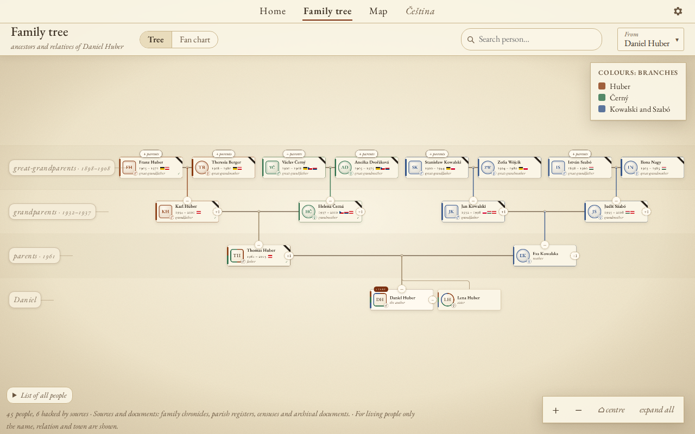
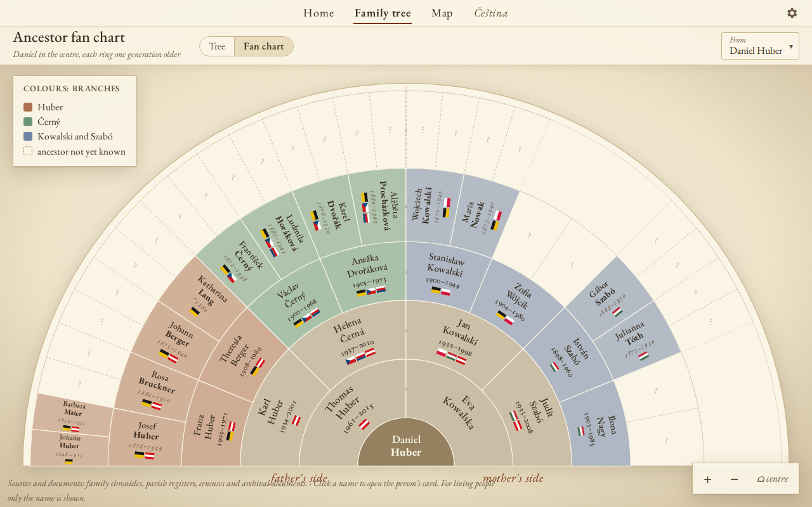
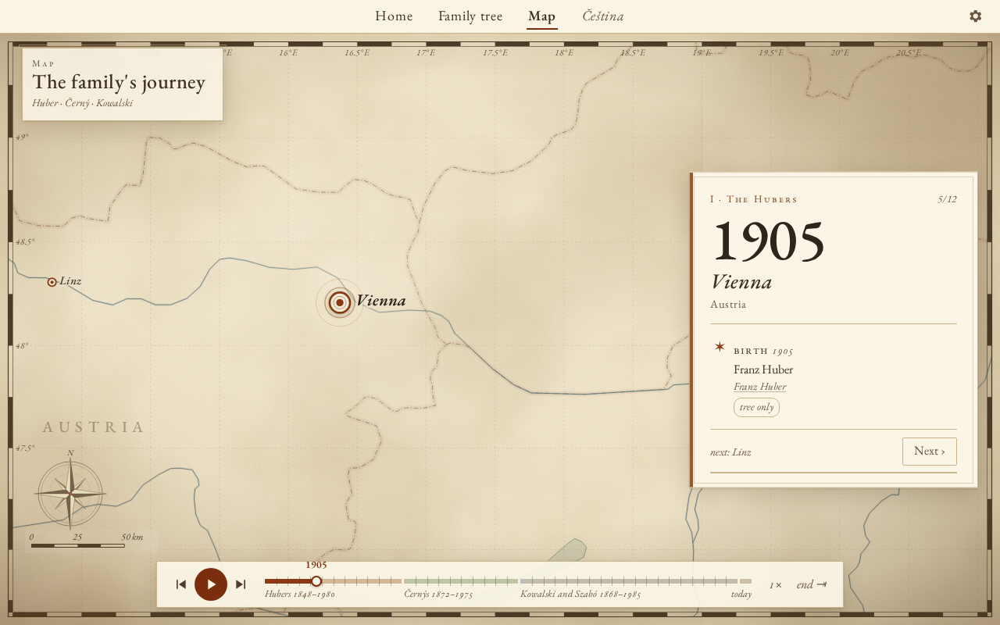
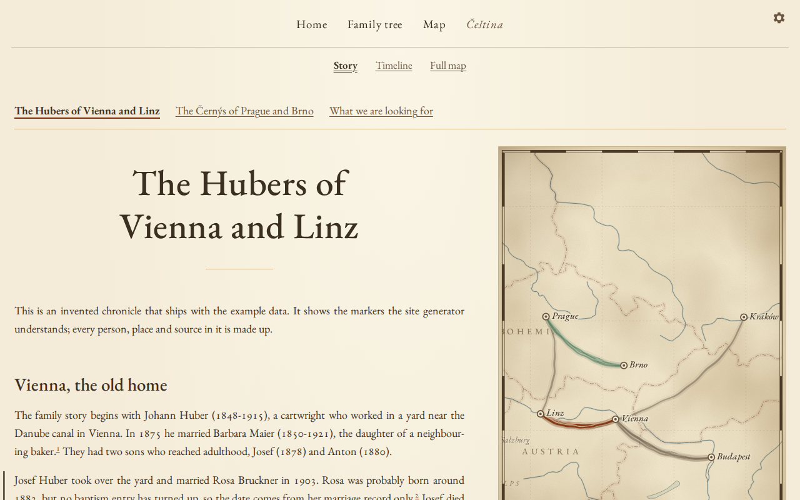
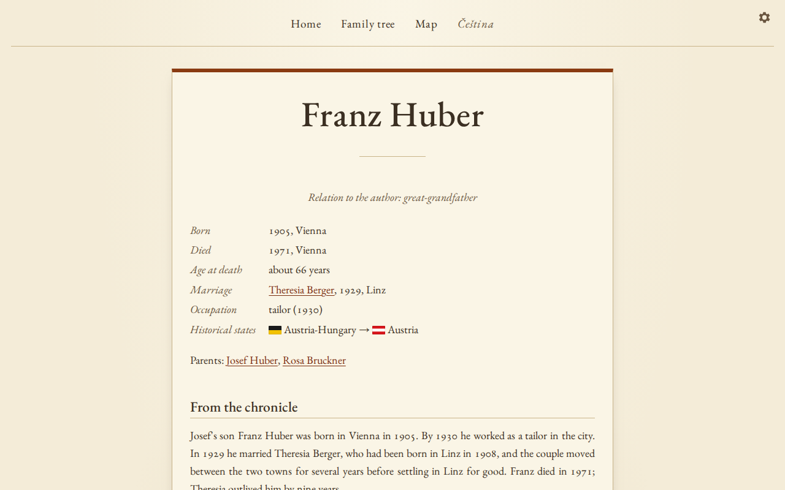
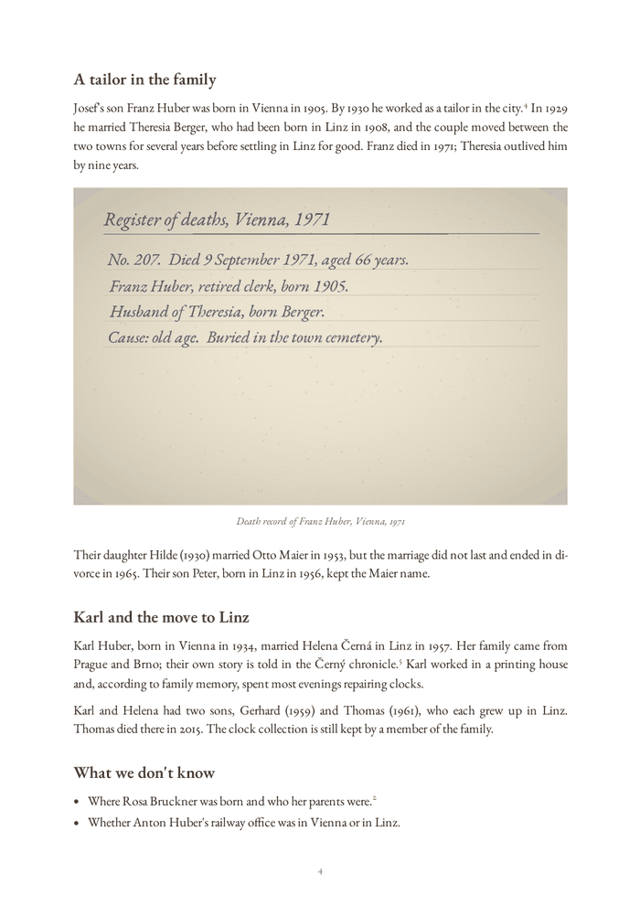
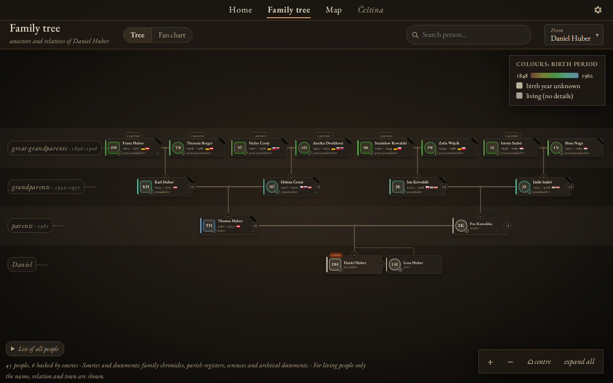
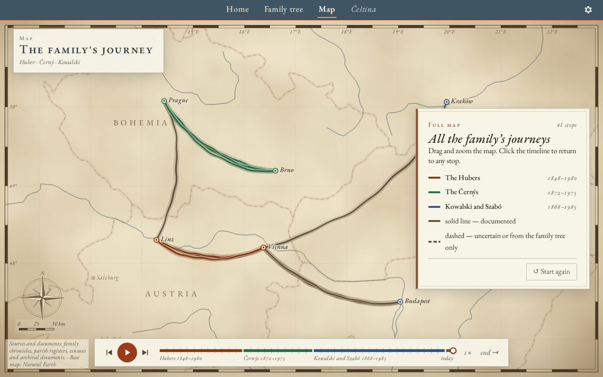
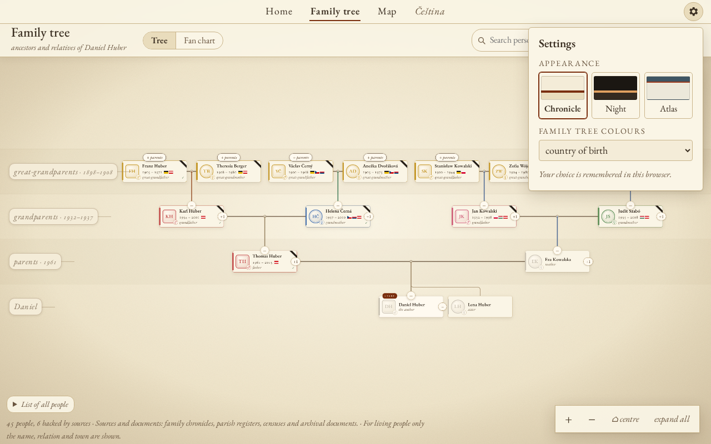
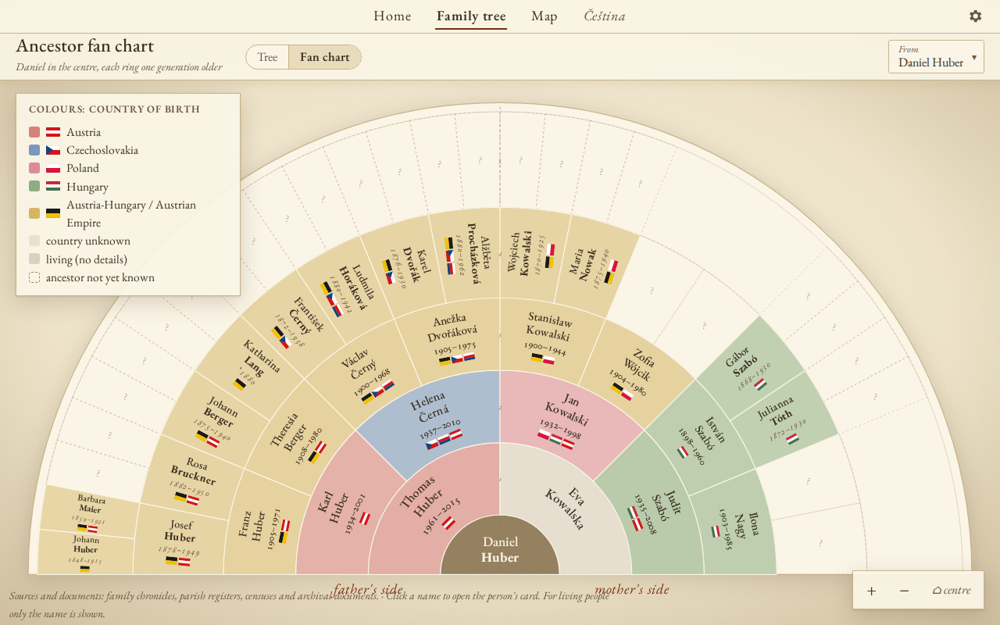

# family-chronicle

Turn a GEDCOM file and a few Markdown chronicles into a static family website: an interactive
tree, an ancestor fan chart, an animated migration map, one page per chronicle and per deceased
person, and the documents behind it all. The same chronicles can be typeset into a PDF book.
Living people are protected by rules, and the build ends with a check that refuses to finish
when something leaks.

The site is plain HTML, JSON and a little JavaScript. There is no server, no database and no
tracking, so you can host it anywhere that serves files.

Three looks (Chronicle, Night and Atlas) and the colours of the tree are chosen in a settings panel (the
gear in the header). The tree and the fan chart can colour people by branch, by the country they were
born in (with small flags of the historical states), by birth period or by whether a document backs
them; the tree also marks the path from a selected person to the start, labels the generations with
their birth years and shows a minimap when it does not fit.

| Tree | Fan chart |
|---|---|
|  |  |
| **Migration map (film)** | **Chronicle with a map** |
|  |  |
| **Person page** | **A page of the PDF book** |
|  |  |
| **Night theme, tree coloured by birth period** | **Atlas theme, the whole map** |
|  |  |
| **Settings panel** | **Fan chart coloured by country of birth, with flags** |
|  |  |

All screenshots come from `example/`, an invented family (the Hubers) that ships with the repo.

**Status: work in progress.** It runs my own family site, but it is young as a public project.
The weakest part right now is touch control on phones: the tree and the map work, but panning,
zooming and tapping are clumsy on a small screen. Issues, ideas and pull requests are welcome.

## Where this comes from

I built this for my own family history, about 650 people in 10 branches, together with Claude Code.
This repository is the generic engine extracted from that work, with a made-up example family
instead of mine. I am sharing it because genealogists who use an AI assistant keep running into
the same wall: a chart script that works for three generations gets hard to extend and keep clean
as generations and special cases pile up. The last section describes what kept this one
maintainable.

## Quick start

You need Python 3 (developed and tested on 3.14). Node.js is only needed for the optional JavaScript tests, and a
Chromium or Chrome only for the PDF book.

```bash
python3 -m venv .venv
.venv/bin/pip install -r requirements.txt

# build the example site (the output folder must be outside the config's folder)
.venv/bin/python -I build.py --config example/site.json --out /tmp/family-site --today 2026-11-23

# look at it: open /tmp/family-site/family/index.html straight from disk,
# or serve it, as it will be served on the web
cd /tmp/family-site && python3 -m http.server 8000
# open http://127.0.0.1:8000/family/
```

`--today` fixes the date used for the "is this person living" rule, so builds are reproducible.
Leave it out to use the real date.

The build prints warnings (for example a place from the GEDCOM that is missing in `places.json`
is left off the map, not fatal) and ends with `Done: N files in ..., check ok.`

Exit codes: `0` ok, `1` bad input or a finding of the output privacy check, `2` refused output
folder (filesystem root, your home, the config's folder, anything inside or above it, or an
existing `<site_dir>` folder that is not the output of a previous build). The build deletes and
recreates `<out>/<site_dir>` only when a `manifest.json` from an earlier build sits next to it; any
other folder of that name is left alone and the build stops.

The output folder gets the site in `<site_dir>/`, plus `manifest.json` (a SHA-256 for every
file) and `approval.md` (a list of what to read before publishing). Nothing is uploaded by the
build; publishing is your decision.

## Your own family

Copy `example/` and replace its files:

| file | what it is |
|---|---|
| `family.ged` | your GEDCOM export (UTF-8, UTF-8 or UTF-16 with BOM, or a `1 CHAR ANSI`/`ASCII` file as Windows-1252; CRLF, `CONC`/`CONT`, any ID style, unknown tags are fine). ANSEL files are refused with a message to convert them to UTF-8 first. |
| `site.json` | the configuration, see below |
| `places.json` | `{town: {coords: [lat, lon], country: {lang: name}, aliases: [...], region: "..."}}` (`region` is optional, see "Historical states"); a GEDCOM place not listed here is just left off the map |
| `states.json` | optional historical states and their flags, see "Historical states" |
| `events.json` | optional hand-written events (moves, war, transports) that the GEDCOM does not hold; each `description` needs a text for every language in `languages` |
| `documents.json` | optional list of scans and what they prove; may live in a subfolder, its paths are still relative to `site.json` |
| `basemap.geojson` | optional map background, see "Basemap" |
| `chronicles/*.md` | one Markdown chronicle per branch, translations as `name.<lang>.md` |

### `site.json`

All paths resolve against the folder of `site.json`, so you can run the build from anywhere.

| key | meaning |
|---|---|
| `root` | GEDCOM id (`I1` or `@I1@`; the same goes for `roots`, `living_extra`, `deceased_extra`, `exclude` and the keys of `living_town`) of the person the site is centred on. The site covers their ancestors, those ancestors' siblings and the siblings' descendants, plus spouses. The root's own descendants stay out. |
| `gedcom`, `places`, `events`, `documents`, `basemap`, `states` | file names (the last four are optional) |
| `base_url` | public URL, used for `sitemap.xml` |
| `languages`, `default_language` | for example `["en", "cs"]` and `"en"`. The default language lives at the site root, others under `<lang>/`. Texts come from `locales/<lang>.json`; to add a language, add that file with the same keys as `en.json`. |
| `site_dir` | name of the folder inside the output that holds the site |
| `branches[]` | `key`, `name{lang: text}`, `color`, `roots[]` (GEDCOM ids where the branch starts; it includes their ancestors) and optional `chronicle` (path to the default-language `.md`) and `map_chapter`. A branch without a chronicle gets no story page, but still appears in the tree and on the map; with `map_chapter` (the key of another branch) it has no chapter of its own in the film on the map, its stops join that branch's chapter. |
| `strings{lang: {key: value}}` | overrides any key of `locales/<lang>.json`; nested objects merge key by key. This is where the texts of *your* family go: `intro`, `branch_descriptions{branch key: text}`, `chapters{chronicle slug: {title, short, subtitle}}`. The shipped locales are generic and know no branch. `{root}` and `{root_full}` become the root person's given and full name. |
| `map_labels` | optional `[{text{lang: text}, lat, lon, kind}]` with `kind` `region` (spaced capitals), `ridge` (small italic capitals) or `town` (a dot and a name). The map has no built-in place names; the camera limits come from your places (bounding box plus a margin), so it fits any part of the world. |
| `ignore_places` | place names that are too coarse to draw (countries, regions) |
| `living_town{id: town}` | the one thing shown about a living person besides name and relation; must be a place from `places.json` |
| `living_extra`, `deceased_extra` | force a person to be treated as living / deceased when the dates cannot tell |
| `exclude` | ids that are removed from the site altogether |
| `living_years` | the cut-off for the living rule, see "Living people". Must be an integer **>= 100**; a lower value is refused. |
| `check_exceptions` | strings the output check ignores, see "Living people" |
| `documents_cutoff_year`, `documents_skip_dirs` | documents without a linked person are published only when older than the cut-off year; folders to skip when drafting `documents.json` |
| `open_questions_headings{lang: [headings]}` | chronicle sections with these headings are collected on one "open questions" page |
| `chronicle_images` | optional `[chapter slug, snippet, source, crop, caption]` entries for chronicle images |

`docs/data-format.md` is the full contract between the Python build and the browser scripts.

### Chronicle markers

Chronicles are ordinary Markdown. Markers are HTML comments on a line of their own, placed before
the paragraph they belong to, so the same file typesets cleanly into the book.

```markdown
## Vienna, the old home

<!-- place: Vienna; Linz -->
<!-- person: I43; I44 -->
The family story begins with Johann Huber (1848-1915), a cartwright in Vienna.[^1]

<!-- web:hide -->
A passage that appears in the family's private print but never on the web.
<!-- /web:hide -->
<!-- web:text: A short public replacement for the hidden passage. -->
```

| marker | effect |
|---|---|
| `<!-- place: A; B -->` | the paragraph is tied to these places; the map beside the chronicle follows the text |
| `<!-- person: I12; I13 -->` (or `@I12@`) | ties the paragraph to people |
| `<!-- web:hide -->...<!-- /web:hide -->` | removed from the web (and from the book by default) |
| `<!-- web:text: ... -->` | plain text shown on the web instead (a comment in the private book) |
| `<!-- img: snippet -->` | lets a translation anchor a book image to the same paragraph |
| `[^1]` footnotes | become the sources of the chapter |

Every other comment is dropped from the output. A translation of `chronicles/huber.md` is
`chronicles/huber.cs.md`; when it is missing the default-language file is used.

## Looks, colours and settings

The gear in the corner of the header opens the settings panel on every page. The choices are kept in the
browser (`localStorage`), nothing is sent anywhere.

- **Look**: *Chronicle* (the default paper look), *Night* (dark, amber links, a night print of the map) and *Atlas*
  (a slate bar, rusty accents and a graticule). Print is always Chronicle. The look is set in `<head>` before the
  page is painted, so there is no flash of the default colours.
- **Colours of the family tree**, for the tree and the fan chart: *branches* (the colour from `site.json`), *country
  of birth* (the colour of the flag of the first historical state), *birth period* (older is darker and warmer) and
  *evidence* (a document backs the person or not). The legend in the tree and the fan chart only says which colours are
  on; the living always get one neutral colour except in the branch mode. `#colors=era` in the address picks a mode
  for a shared link.
- **Tree**: a click on a person marks the path to the start (ancestors in the line, for a sibling through the shared
  parents, for a partner through the spouse); the rows are tinted by generation and labelled with the span of birth
  years; a minimap appears on wide screens when the tree does not fit.

### Historical states

An optional `states.json` (name it in `site.json` as `states`) describes which state a place belonged to in which
years, so that cards, the fan chart and person pages can show small flags and the colour mode "country of birth"
works. Everything in it is your data; nothing is built in.

```json
{
  "flags":   {"empire": {"stripes": ["#1a1a1a", "#f2c200"], "color": "#c69a2e"}},
  "states":  {"austrian-empire": {"name": {"en": "Austrian Empire", "cs": "Rakouské císařství"}, "flag": "empire"}},
  "regions": {"Austria": [[0, "austrian-empire"], [1867.45, "austria-hungary"], [1918.87, "austria"]]}
}
```

A flag is 1 to 6 stripes (`direction` `horizontal` or `vertical`) with an optional `hoist_triangle`; it is drawn
as a small SVG. A region is a timeline `[from_year, state]`, each entry valid until the next (a year may carry a
fraction: `1918.82` is late October 1918). A place belongs to the region named in its `region` entry in
`places.json`, otherwise to the region named like its country in the default language. For a deceased person
the build follows the dated events with a place (birth, marriage, death, burial) and works out the states they lived in; a
marriage with a living partner is left out. For the living there are no states and no flags, because a state at a
given year would give away their age. `docs/data-format.md` has the details and the checks.

## Living people

A person is **living** when they have no death or burial record and were born at most
`living_years` (default 100) years ago, or when no birth year is known at all. The check uses
the year only and errs on the side of caution. `living_extra` and `deceased_extra` override it.

For a living person the site shows the name, the relation to the root and, optionally, the town
from `living_town`. No dates, no person page and no documents that mention them. Dates of living people inside chronicle text are redacted by the build.

The build ends with `check_output`, a scan of every generated `.html .json .xml .txt .js .css`
file for:

- a birth or marriage date of a living person in many written forms,
- a year of a living person within 80 characters of their name,
- e-mail addresses and phone numbers,
- any file in `documents/` that is not on the allow-list derived from `documents.json`.

Month names and "born" words of Czech and English are built in. For another language, add an
optional block to `locales/<lang>.json`; redaction and the check then use it for every configured
language (the block is never sent to the browser):

```json
"privacy": {
  "months": [["Januar", "Jänner"], ["Februar"], ["März", "Maerz"], ["April"], ["Mai"], ["Juni"],
             ["Juli"], ["August"], ["September"], ["Oktober"], ["November"], ["Dezember"]],
  "birth_prefixes": ["geb."]
}
```

`months` has 12 lists (all spellings of January ... December), `birth_prefixes` the words that
stand before a birth date (they are removed with it).

When something is found, the build exits with `1` and writes `"check": "failed"` into
`manifest.json`. The only legitimate way out is to list the harmless string in `check_exceptions`
in `site.json`, where it is visible in review. Do not edit the output by hand, and do not
publish a manifest that says `failed`.

## Documents and crops

`documents.json` describes scans: `id`, `source`, `people`, `main`, `year`, `description`
(`{lang: text}`), `citation`, `verified`. Optional `crop` (a region of the scan), `marked` (a copy
with the relevant spot highlighted), `foreign_work` and `crop_only`.

A document is published only when none of its linked people is living, excluded or outside the
scope. A foreign work (someone else's published scan) is published only as a crop, and
`crop_only` does the same for your own sheet that also mentions a living person. Published
images are re-encoded to WebP without metadata. To get a skeleton for scans that are not listed
yet:

```bash
.venv/bin/python -I familychronicle/documents_draft.py --config example/site.json > /tmp/draft.json
```

People are left empty in the draft; a human fills them in.

## Basemap

The map background is cropped Natural Earth 50m data. `example/basemap.geojson` is included.
For your own places, generate one (needs network, or `--source-dir` with already downloaded
`ne_50m_*.geojson` files). Without `--output` the file is written to the path of `basemap` in the
config (or next to the places file), which would overwrite the shipped example, so give an
`--output` when you try it on the example:

```bash
.venv/bin/python -I familychronicle/basemap.py --places example/places.json --margin 3 --output /tmp/basemap.geojson
.venv/bin/python -I familychronicle/basemap.py --bbox 5,36,38,55 --output /tmp/basemap.geojson   # lon0,lon1,lat0,lat1
.venv/bin/python -I familychronicle/basemap.py --config my-family/site.json                       # writes the `basemap` file of your config
```

The map camera is limited to the bounding box of your places plus a margin of a quarter of their
spread (at least one degree). Generate the basemap with a `--margin` at least that large, or the
edge of the data shows.

## PDF book

```bash
.venv/bin/python -I book.py --config example/book.json --out /tmp/family-book.pdf --today 2026-11-23
```

The book takes the same chronicles, one chapter per branch that has one, with footnotes as
"Sources" at the end of each chapter, and typesets them in EB Garamond through headless Chromium
(found as `chromium`, `chromium-browser`, `google-chrome`, `google-chrome-stable`, `chrome`, in
the macOS app bundles of Chrome or Chromium, via the `CHROME` environment variable, in
Playwright's download in `~/.cache`, or pass `--chrome PATH`). The browser's sandbox stays on; only
root gets `--no-sandbox` automatically. If Chromium cannot start for lack of user namespaces, pass
`book.py --no-sandbox`. Without `--out` the PDF is written
to the `output` name from `book.json`, next to it.

`book.json` keys: `site` (path to `site.json`), `title`, `subtitle`, `tagline`, `colophon`,
`output`, `language`, `include_hidden` (a JSON `true` or `false`; any other value is an error), and `images[]` (`chronicle`, `after_text` = a snippet of
the paragraph the image follows, `source`, optional `crop` as `[x0, y0, x1, y1]` in pixels,
`caption`).

`include_hidden` defaults to **false**: `web:hide` passages are removed, `web:text`
replacements are shown and the dates of living people are redacted, exactly like on the web, so
the book is as safe to hand out as the site. It is gated the same way as the site, too: an image
is typeset only when it matches a document that the site would publish (same whitelist as
`documents.json` and the living rule; another crop of a fully published sheet is fine, other
crops of a `crop_only` or foreign-work scan are not), otherwise the book stops with an error that
names the image; and the generated HTML goes through the privacy check (`check_exceptions` of
`site.json` apply) before anything is printed, a finding exits with `1`. Set `include_hidden` to
`true` for a raw private family print that is typeset as written, with no such checks. Treat such
a PDF as private.

## Tests

```bash
.venv/bin/python -I -m unittest discover -s tests -t .     # Python
node --test tests/*.test.mjs                               # film logic, map engine, colouring, string keys, data contract
```

An optional browser smoke test walks every page of a served build in headless Chromium at
desktop and mobile size and fails on console errors, CSP violations, requests outside the
origin, HTTP errors >= 400, horizontal overflow on mobile and serious axe-core violations; it also switches the theme and the colour mode in the settings
panel and checks that the choice is applied, remembered and shared between the tree and the fan chart:

```bash
PLAYWRIGHT_MODULES=/path/to/node_modules node tests/browser.mjs http://127.0.0.1:8000/family/
```

`PLAYWRIGHT_MODULES` must point to a `node_modules` folder that contains `playwright` and
`axe-core`. Without it the script says it is skipped and exits `0`.

## Extending it with Claude Code

The point of this repository is not the charts but the way they stay maintainable. What worked:

- **Everything is generated from data.** The inputs are one GEDCOM and a few JSON files; nothing
  is placed by hand. A new branch, language or special case is a line in `site.json`, not an
  edit to a script. If you catch yourself (or Claude) hard-coding a name, a place or an id into
  code, stop and add a config key instead.
- **Tests are the guardrail.** Python unit tests cover the GEDCOM reader, scope, privacy, places,
  documents, chronicles, build and book. Node tests cover the pure film logic and the map
  engine. The browser smoke test catches what only a real browser shows. With these, Claude can
  refactor boldly and you find out within seconds when it broke something. Ask for a test with
  every new field and every special case, and keep the awkward real-world GEDCOM quirks
  (`tests/data/mini.ged`) as fixtures.
- **The privacy check is the last gate.** It looks at what is actually written to disk, not at
  what the code intended. Make the assistant fix the cause when it fires, never loosen the check
  to get a green build.
- **A `CLAUDE.md` in the repo.** It states the rules once (how to run tests, no hard-coding,
  privacy is never bypassed) so every new session starts with them. Keep it short and update it
  when you learn a rule the hard way.
- **Look before you change anything visual.** Ask for a screenshot or a quick mock-up first,
  agree on it, then implement, then screenshot again at desktop and mobile size. Chart code can be
  perfectly "correct" and still look wrong.
- **Small focused modules.** One file per concern (`gedcom.py`, `scope.py`, `privacy.py`,
  `places.py`, `events.py`, `chronicles.py`, `states.py`, ...; `tree.js`, `fan.js`, `film.js`, `coloring.js`,
  `map-draw.js` in the browser). Small files fit in a context window and keep a change local.
- **A written contract between Python and JS.** `docs/data-format.md` lists every key the build
  writes and the scripts read. When the format changes, the doc, the build and the scripts change
  together, and `tests/js-strings.test.mjs` checks that every string key the scripts use exists
  in every language file.
- **Make one thing per session.** A small, single-sentence change with its test is easy to
  review; a vague "improve the chart" is not.

## Licence and credits

Code: MIT, see `LICENSE`.

- Font: **EB Garamond** by the EB Garamond Project Authors, SIL Open Font License 1.1
  (`fonts/OFL.txt`).
- Map background: **Natural Earth** (naturalearthdata.com), public domain.
- The idea of the ancestor fan chart follows the fan chart of the rodokmen-skill project
  (J. Šaršon, MIT); the code here is original (see the header of `static/fan.js`).
- Every person, place record and scan in `example/` is invented.
